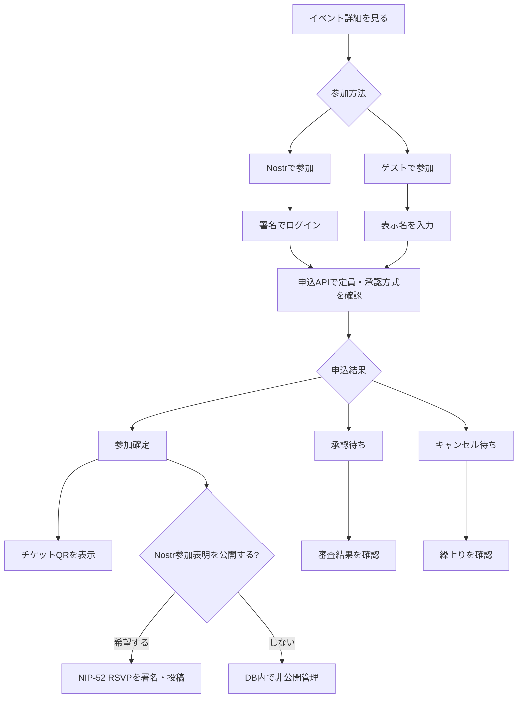
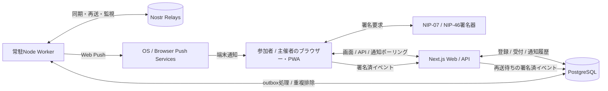

# Gather（仮称）— Nostrイベント管理システム 要件定義・技術設計書

> Version: 1.0 / 2026-10-28  
> 対象: Claude Codeによる新規実装  
> 言語: 日本語優先（英語切替に対応）  
> プロダクトの一言: **「イベントを作る、参加する、迎える」を一つの画面で。Nostrにつながる、誰にでも使いやすいイベント管理アプリ。**

---

## 0. Claude Codeへの最重要指示

この設計書に基づいて、**動くMVPを実装**する。見た目だけのモックアップで終わらせないこと。認証、Nostr署名・リレー公開、参加登録、定員、QRチェックイン、通知、DB永続化、テスト、ローカル起動まで実装する。

優先順位は **わかりやすさ > 安全性と正しいデータ管理 > Nostr標準への準拠 > 装飾や多機能性**。ただし安全性を犠牲にして簡単にしないこと。

- 既存リポジトリがあれば先に構造を調査し、互換性を保つ。新規ならこの文書の技術構成で作成する。
- NIP実装前に公式仕様を再確認する。特に NIP-52 は `title` と RSVP の `status` タグを使う現行仕様に合わせる。古い記事の `name` や `L`/`l` ラベルを根拠に実装しない。
- 秘密鍵 (`nsec`) をサーバー・DB・ログに保存しない。ブラウザーにも平文で保存させない。
- Nostrの「参加表明」と、このアプリが管理する「参加確定・定員・チェックイン」は**別の概念**として扱う。
- 通知は「アプリ表示中の通知」と「バックグラウンドのWeb Push」の両方を実装する。Nostrリレー購読だけでは閉じた端末への通知を保証できない。
- まずV1を完成させる。Lightning決済・高度な共同主催・チケット販売などは後回し。

## 1. プロダクトの目的

### 1.1 解決する課題

現状、多くのNostrアプリはイベントの「投稿・発見」はできても、主催者が使う「参加者一覧・定員・当日の受付・通知」が分断されがち。一般的なイベント管理サービスは使いやすい一方、Nostrのソーシャルグラフや公開プロトコルとの接続が弱い。

**目指す体験**

1. 主催者はNostrでログインし、タイトル・日時・場所を入力して1分以内を目標に公開できる。
2. 参加希望者はログインせずイベントを読める。NostrユーザーはNostrで申込み、一般の人はゲストとして申込める。
3. 申込みが入れば主催者画面に通知が表示される。許可した端末にはWeb Pushも届く。
4. 当日はQRを読み取るだけで受付でき、主催者画面のチェックイン数が更新される。
5. 公開イベントはNIP-52でNostrにも公開し、対応クライアントで再利用できる。

### 1.2 対象ユーザー

| ロール | 主な作業 | V1の権限 |
|---|---|---|
| 主催者 | 作成・編集・参加者確認・通知受信・受付 | 自分のイベントだけ管理可能。公開にはNostr認証が必要 |
| Nostr参加者 | イベント閲覧・申込・取消・チケット表示 | 自分の申込だけ操作可能 |
| ゲスト参加者 | 名前を入力して申込・チケット表示 | 推測困難な秘密のチケットURLで自分の申込だけ操作可能 |
| 一般閲覧者 | イベント検索・共有 | ログイン不要 |
| 受付スタッフ | イベント当日のQR確認 | V1は主催者自身が兼任。スタッフ招待はV2 |

### 1.3 成功指標（目標値）

- 主催者の初回イベント公開: 基本入力は「タイトル・日時・場所」で完了でき、所要時間は目標1分以内。
- 参加登録: Nostrログイン済みなら原則1～2アクション、ゲストは名前と確認だけ。
- 登録・チェックイン後の主催者画面更新: 開いている画面は通常5～10秒以内を目標。
- 許可されたWeb Push: できるだけ速く配送し、失敗時はリトライする。ただしOS・ブラウザー・通信による**到達保証はしない**。
- 二重登録・二重チェックイン・定員超過が起きない。
- スマホ片手で主催者が受付・確認できる。

## 2. スコープ

### 2.1 V1 / MVPで必須

- 公開イベント一覧、検索・絞り込み、詳細、共有URL。
- Nostrログイン（NIP-07、NIP-46の対応を目指す。モバイル端末でも利用できる導線）。
- イベント作成・編集・キャンセル、画像、日時・タイムゾーン、会場、説明、定員、承認方式。
- 公開イベントをNIP-52（kind `31922` / `31923`）で署名・リレー投稿。
- Nostr参加者の申込・取消。**公開RSVP（kind `31925`）は本人の明示的な選択により投稿**。
- ゲストの名前による申込（メールは任意。メール配送はMVPの必須条件にしない）。ゲスト情報はリレーに公開しない。
- 自動承認／手動承認、満席とキャンセル待ち、重複登録・定員超過の防止。
- 主催者ダッシュボード：申込一覧、申込数、参加確定数、待機者、当日チェックイン数。
- 秘密トークン入りチケットQR、主催者のカメラでチェックイン、手動チェックイン。
- 新規申込・キャンセル・承認待ち・チェックイン・外部Nostr参加表明のアプリ内通知。
- Web Push（PWA manifest、Service Worker、VAPID、通知ON/OFF）。
- リレー一時障害の表示・再送、署名イベント重複排除、バックフィル。
- 日本語UI、英語切替を考慮した構造、レスポンシブ対応。

### 2.2 V1に入れないもの

- Lightning有料チケット、決済、払い戻し、Zapによる参加確定。
- 複数主催者の共同編集／権限委譲（V2）。
- 定期開催ルールの自動展開（NIP-52自体も定期開催を定義しない）。
- 座席指定、複雑なチケット種別、複数日をまたぐ券種管理。
- 秘匿性が必要な招待制イベントの暗号化配信。
- 既存のすべてのNostrクライアントへの通知保証。

## 3. 体験設計・情報設計

### 3.1 最重要UI原則

- トップの主動作は **「イベントを探す」「イベントを作る」「自分のイベント」** の3つ。
- 技術用語を表に出さない。「NIP-52」「リレー」「naddr」は通常画面で表示しない。
- 作成画面は**1ページ完結**。「詳細設定を開く」に定員・承認制・公開設定・リレーを収納。
- 行動結果は日本語で明確に：`公開しました`／`申込みました`／`承認待ちです`／`受付しました`／`通信に失敗しました（再試行）`。
- 満席・承認待ち・確認済み・受付済みが視覚的に区別できる。
- ボタンや入力はスマホの親指で押しやすく、文字は小さすぎない。
- カード主体。管理画面は表だけで埋めず、数字と「次にやること」を上部に表示。
- キーボード・スクリーンリーダー・色覚多様性を考慮し、ARIAとフォーカスリングを実装。
- UIコンポーネントを共通化。ダミーボタンや飾りだけの通知ベルを作らない。

### 3.2 画面一覧とURL案

| 画面 | URL | 必須機能 |
|---|---|---|
| イベントを探す | `/` | カード一覧、開催日、タグ、検索、近く開催などの表示 |
| イベント作成 | `/create` | 主催者認証、入力、プレビュー、公開 |
| 公開イベント詳細 | `/e/[naddr]` | NIP-19デコード、案内、申込み、共有、カレンダー追加 |
| アプリ内イベント詳細 | `/events/[slug]` | 公開／限定リンクの詳細、Nostr座標とのマッピング |
| 主催者ダッシュボード | `/dashboard` | 自分のイベント、通知、今後の予定 |
| イベント管理 | `/dashboard/events/[id]` | ステータス、参加者一覧、承認、編集、受付への導線 |
| 当日受付 | `/dashboard/events/[id]/checkin` | カメラQRスキャン、名前検索、成功/重複/無効の表示 |
| チケット | `/ticket/[token]` | QR、イベント情報、申込状態、取消。トークンを秘密扱い |
| 通知 | `/notifications` | 履歴、既読管理、リンク移動 |
| 設定 | `/settings` | 端末通知、アカウント、リレー設定 |

### 3.3 作成画面のイメージ

```text
┌───────────────────────────────────────┐
│ イベントを作る                        │
│                                       │
│ イベント名 [_______________________] │
│ 日付       [ 2026/11/07 ▼ ]          │
│ 開始       [ 19:00 ▼ ] 終了[21:00 ▼] │
│ 場所       [_______________________] │
│                                       │
│ 説明・画像を追加する  ＋             │
│ 詳細設定                  ▾           │
│                                       │
│ [ プレビュー ]   [ 公開する → ]       │
└───────────────────────────────────────┘
```

- デフォルトTZは `Asia/Tokyo`。必要なら別のIANAタイムゾーンを選択できる。
- 作成時、日付と時間が矛盾していたら即時検証。画像は未選択でも公開可能。
- 公開前に「Nostr上で公開情報が誰からでも閲覧可能」であることを一度だけ明示。
- 署名キャンセル時はドラフトを保持し、再試行可能にする。

### 3.4 主催者画面のイメージ

```text
イベント: ビットコイン勉強会       [編集] [共有]
────────────────────────────────────────
[ 参加確定 18 / 30 ] [ 承認待ち 2 ] [ 受付済み 11 ]

🔔 新しい参加申込が1件届きました

[参加者] [キャンセル待ち] [当日受付] [通知]

山田さん      参加確定         [詳細]
Nostrユーザー 承認待ち         [承認] [拒否]
ゲスト        受付済み         [詳細]

[ カメラでQRを読み取る ]
```

### 3.5 参加申込みの流れ



- `Nostrで参加` は本人確認をNostrの署名で行う。署名拒否・失効時も誤登録しない。
- `ゲストで参加` は秘密チケットURLを発行。紛失すると本人確認なしでは復元できない旨を明示。
- Nostr公開RSVPは参加意思を公開する行為。**公開に明示同意**を求め、デフォルトOFFとする。
- 主催者に通知するのは、実際の申込みがDBで成立したとき。公開RSVP送信の有無では左右されない。

## 4. Nostr連携仕様（必読）

### 4.1 標準と用途

| 仕様 | 用途 | V1 |
|---|---|---|
| NIP-01 | Nostrイベント署名・検証・リレー送受信・置換可能イベント | 必須 |
| NIP-07 | ブラウザー署名拡張によるログインと投稿 | 必須 |
| NIP-46 | リモートサイナー接続、モバイル端末での認証導線 | 推奨必須（難所なら優先実装タスク化） |
| NIP-19 | `npub`・`naddr`のURLエンコード／デコード | 必須 |
| **NIP-52** | `31922` 終日イベント、`31923` 時刻指定イベント、`31925` RSVP | 必須 |
| NIP-65 | ユーザーの書込・受信リレーの発見 | 必須 |
| NIP-98 | Nostr署名によるHTTP認証／セッション確立 | 必須 |
| NIP-09 | 公開イベント削除リクエスト（実削除保証なし） | 対応 |
| NIP-17 / 44 | Nostrの暗号化DM通知（互換性に差あり） | V2。Web Pushの代替としない |
| NIP-52 `31924` | 複数イベントを束ねるカレンダー | V2 |

### 4.2 公開イベントをどう保存するか

**公開内容の正本 = 主催者が署名したNIP-52イベント。**

- 時刻指定イベントは `kind:31923`、終日イベントは `kind:31922`。
- 同じイベントの編集では `pubkey + kind + d` を変えずに新しい署名イベントを公開する。`d`はイベント作成時のランダムな一意ID。
- NIP-52タグ：`d`、`title`、`start`、`end`、`start_tzid`、`end_tzid`、`D`、`location`、`summary`、`image`、必要なら`t`・`r`。説明本文は`content`。
- 時刻指定イベントの`start`と`end`はUTC基準のUnix**秒**。`D`はイベントが存在する各UTC日の`floor(unix_seconds / 86400)`。複数日にまたがる場合は必要な数の`D`を付ける。
- 終日イベントは`start`を`YYYY-MM-DD`、`end`を**終了日の翌日（exclusive）**として扱う（開始日のみの単日では`end`省略も可）。
- NIP-19の`naddr`で共有リンクを組み立てる。NIP-65から本人の書込リレーを優先し、アプリの安全なフォールバックリレーも使う。
- リレーへの公開が成功したかをリレー単位で追跡。最低1リレーのACK（`OK true`）を確認後に `published`。全失敗なら `retrying/failed` を表示。成功した分は再送時に署名イベントをそのまま再配信する。
- **署名自体は本人の署名器で行う。**サーバーは署名済イベントを保持・再送してよいが、主催者の秘密鍵を持たない。
- 他のクライアントから同じ`pubkey + kind + d`が更新された場合も、署名検証後に新しい版を反映。ただし定員・承認方式などアプリ固有設定は自動で上書きしない。

#### NIP-52時刻指定イベントの雛形（署名前）

```json
{
  "kind": 31923,
  "created_at": 0,
  "tags": [
    ["d", "<uuid-or-random-id>"],
    ["title", "Nostr Meetup"],
    ["summary", "初心者歓迎のイベント"],
    ["start", "<unix-seconds>"],
    ["end", "<unix-seconds>"],
    ["D", "<floor(start/86400)>"],
    ["start_tzid", "Asia/Tokyo"],
    ["end_tzid", "Asia/Tokyo"],
    ["location", "Tokyo"],
    ["t", "meetup"]
  ],
  "content": "イベントの詳しい説明"
}
```

`created_at` と`<>`のプレースホルダーは実装で有効な値に変換し、Nostrライブラリによる署名後に`id/pubkey/sig`を得る。複数UTC日をまたぐ場合は追加の`D`を付ける。このJSONは完成済イベントではなく、形式の説明である。

### 4.3 NIP-52 RSVP / 外部クライアントとの相互運用

参加者が「Nostrに参加表明を公開」を選んだ場合：

- 参加者本人のpubkeyで `kind:31925` を署名する。
- `a` = `<eventKind>:<eventAuthorPubkey>:<eventD>`（必須）。
- `d` = RSVPの安定ID（初回に生成し、後から編集・取消でも**同一IDを再利用**）。
- `status` = `accepted` / `tentative` / `declined`（必須）。取消時は同一`d`で`declined`を公開できる。
- `p` = 主催者pubkey（任意だが付ける。外部クライアントからの検出に有益）。
- `e` = 対象イベントの特定版のID（任意。更新との関係に注意）。
- `.content` は任意の自由記述。個人情報は入れない。
- 古い実装の`L/l`ラベルではなく、2026年時点の公式NIP-52の`status`タグを優先する。

**極めて重要:** NIP-52 RSVPの`accepted`は「行くつもり」という意思表示であり、アプリ上の「定員内で参加確定」と**同義ではない**。NIP-52は承認・定員・チケット配布のルールを規定しない。

外部Nostrクライアントから取得したRSVPの扱い：

1. `#a`で対象イベントのRSVPを購読・バックフィル。すべて署名検証し、`a`とpubkeyを確認。
2. `(event_coordinate, attendee_pubkey)`を軸に最新の意思表示を集約。同一ユーザーが別`d`を出す可能性にも対応する。
3. 既にこのアプリで申込済みなら重複で人数を足さず、「公開RSVPと連携済」とする。
4. 未登録の外部RSVPは**「Nostr上の参加表明」**として主催者へ通知・別枠表示し、**自動的に参加確定・定員消費しない**。イベントページからこのアプリ上の正式申込へ誘導する。
5. 別リレー由来の同じ署名イベントや古い再送で二重通知しない。古い版の`e`タグ指定があるときは必要に応じ表示する。
6. 他のNostrクライアントが`p`タグで通知するかはそのクライアント次第。**既存の全クライアントにプッシュを届けられるわけではない**。

### 4.4 公開範囲

- **公開（Nostr）**：イベント情報がリレーに残り、誰でも取得・再配布できる。ゲストの名前・メール・チケットURLはNostrに書かない。
- **限定リンク（アプリ内）**：推測困難なURLによるDB内イベント。NIP-52には一切投稿しない。URLを知る人が転送できるため、厳格な招待制・暗号化イベントではないと表示。
- 公開済イベントを「限定リンク」に切り替えて**過去のNostr上の公開をなかったことにはできない**。画面で注意し、原則切替不可。
- キャンセルはアプリのDB状態を `cancelled` にして申込を停止し、登録者と主催者画面へ通知。公開イベントにはアプリ固有の`status=cancelled`タグ付き更新を署名・公開可能だが、他クライアントによる認識は保証されない。完全削除操作は別途NIP-09削除リクエストとして扱い、不可逆に消せると約束しない。

### 4.5 鍵・署名器・リレー

- PC: `window.nostr`がある場合はNIP-07でログイン。
- モバイル: NIP-46接続（`nostrconnect://` や `bunker://`）を実装。QR・ディープリンク導線を提供。サイナー未接続時はガイドを表示。
- `nsec`の貼り付けやインポートを**MVPのログインUIで求めない**。
- リレーはNIP-65の書込リレーを優先、アプリ設定によるフォールバック（2～4程度）。ユーザーは詳細設定から変更可能。
- WebSocket再接続、指数バックオフ、購読再開、重複イベント除去。オフライン時は現在のDB情報と公開同期失敗を区別して表示。
- 同一署名イベントをリレー間で重複して受け取っても登録・通知は1回。

## 5. データ所有・整合性

本システムは**Nostr+最小限の中央DBのハイブリッド**とする。

| データ | 正本 | 理由 |
|---|---|---|
| 公開イベントのタイトル・日時・場所・説明 | 署名済NIP-52 | 複数クライアントで読み取れる |
| 公開の参加意思（本人が希望した場合） | 署名済NIP-52 RSVP | 他クライアントと相互運用 |
| アプリ内の正式申込・承認・定員・待機列 | PostgreSQL | 定員競合・不正対策・一貫性の担保 |
| ゲストの表示名・メール（任意） | PostgreSQL | プライバシー |
| チケット・チェックイン・通知・Push端末登録 | PostgreSQL | サーバー権限確認・配送・再実行 |
| 限定リンクのイベント | PostgreSQL | 公開リレーへ流さないため |

**禁止:** 署名があるからといってNostr RSVPを無条件に「参加確定」としてカウントする設計。

## 6. 認証と権限

### 6.1 Nostr主催者・Nostr参加者

1. `NIP-07`または`NIP-46`でユーザーのpubkeyを取得。
2. 初回認証時は `POST /api/auth/nostr` への**NIP-98** (`kind:27235`)署名を要求。空bodyで送信し、`Authorization: Nostr <base64(JSON)>` を付ける。
3. サーバー側は署名・id・pubkey・kind・URL・HTTPメソッド・timestamp（例±60秒）・リプレイを検証。
4. 検証後、短期間有効な署名済セッションを `HttpOnly; Secure; SameSite=Lax` Cookieに設定。認証済APIはセッションとCSRF/Originを確認。
5. 主催者権限は `events.owner_pubkey === session.pubkey` で検証。フロントエンドでボタンを隠すだけでは不可。
6. NIP-46のサイナー接続とログイン済Webセッションのライフサイクルを分離。ログアウト時はアプリ側接続情報を破棄。

### 6.2 ゲスト参加者

- 主催者は必ずNostr認証。参加者はゲストとして登録できる。
- ゲスト申込では表示名を必須、メールアドレスを任意とする。メールを収集しても**検証済であるとはみなさない**。
- 32byte以上のCSPRNGによる推測困難なチケットトークンを作る。DBにはハッシュだけ保存。
- ゲストのチケットURLの保有をその申込操作の権限とみなす。紛失・共有に注意喚起。
- 登録後にチケットURLを画面表示し、コピー・保存を促す。メール配送・本人確認付き復旧は後続機能。Nostrログイン済の参加者は、後日ログインして本人確認した上でチケットを再発行できる。古いトークンは失効させる。
- 制限付きゲスト登録を悪用されないようIP/イベント単位レート制限と必要時のTurnstile等を用意。

## 7. 参加登録・定員・キャンセル待ち

### 7.1 登録ステータス

| DB status | UI表示 | 定員を消費 | QRで受付できる |
|---|---|---|---|
| `pending` | 承認待ち | いいえ | いいえ |
| `confirmed` | 参加確定 | はい | はい |
| `waitlisted` | キャンセル待ち | いいえ | いいえ |
| `rejected` | 不承認 | いいえ | いいえ |
| `cancelled` | キャンセル済み | いいえ | いいえ |

**受付済み**は`confirmed`に紐づく`checkins`レコードとして別管理する。`registration.status`だけで受付を表現しない。

### 7.2 定員・競合

- 参加確定数は `confirmed` の数で計算。主催者が定員を未設定なら上限なし。
- `auto_approve` の場合、空席があれば `confirmed`、満席なら `waitlisted`。
- `manual_approve` の場合、まず `pending`。主催者承認時に定員と競合を再検証して確定／待機に振り分ける。
- 申込・承認・キャンセル・繰り上げを**DBトランザクション**で扱う。イベント行の `SELECT ... FOR UPDATE` 等で同時実行を直列化する。
- アカウント参加者は `(event_id, nostr_pubkey)` が一意。ゲストはチケット単位で管理し、レート制限・スパム対策を行う。
- 取消後に空席ができたらキャンセル待ちを先着順に繰り上げ、重複通知を出さない。
- 申込APIにidempotency keyを持たせ、通信再試行でも二重登録させない。
- イベント開始後の申込・受付有効期間はイベント設定に従う。デフォルトは開始前の申込可、当日受付は開始2時間前から終了2時間後まで（変更可）。

## 8. 当日QRチェックイン

### 8.1 チケットの内容

- QRに個人情報（氏名・メール・pubkey）は直接入れない。
- QRは**推測困難なbearerトークン**を表すURL、またはそのトークンを含むデータ。サーバーではSHA-256等でハッシュ照合。
- 読み取り側は主催者としてログイン済みであることを必須にする。一般ユーザーがQR URLを開いたことをもって**チェックインとはしない**。
- QR URLをアクセスログ、解析タグ、外部画像・外部スクリプト、リファラーに漏らさない。`Referrer-Policy: no-referrer`等を設定。

### 8.2 受付の流れ

1. 主催者が `/dashboard/events/[id]/checkin` を開く。
2. カメラで参加者のQRを読み取る。カメラ不可の場合は検索・手動入力。
3. サーバーは署名セッション、主催権限、対象イベント、トークン、申込状態、受付期間を検証。
4. 原子的に `checkins` を1件作成。DBに `(registration_id)` のunique制約を付ける。
5. **成功**：「○○さん、受付完了」。**2回目**：「受付済み（時刻）」で二重カウントしない。**無効**：「このイベントの有効なチケットではありません」。
6. 主催者画面の数値を更新し、`checkin_created`通知レコードを作り、Web Push配送をキューへ登録。

QRトークンを他人に見せる／共有することは可能なので、厳格な本人確認が必要なイベントは受付時に表示名の確認を促す。

## 9. 通知の設計（本プロジェクトの核）

### 9.1 発火条件

| トリガー | 主催者アプリ内 | 主催者Web Push | 参加者側 |
|---|---|---|---|
| 新しい正式申込 | 必須 | 許可端末へ | 結果を申込画面に表示 |
| 承認待ち申込 | 必須 | 許可端末へ | 承認待ちを表示 |
| キャンセル／繰上り | 必須 | 許可端末へ | チケット画面に結果反映 |
| 外部Nostr RSVP検知 | 別カテゴリで通知 | 任意の通知設定 | アプリ外の動作は保証しない |
| **QRチェックイン** | **必須・即時に近く** | **許可端末へ** | チケットに受付済み反映 |
| リレー公開失敗 | 主催者に警告 | 通常は通知しない | － |

### 9.2 方式

- **アプリ内通知:** DBに通知レコードを先に永続化し、開いている画面では5秒程度の軽量ポーリング（初期版）。通知ベル・トースト・履歴を更新。将来SSE/WebSocketに置換可能なインターフェースを定義。
- **Web Push:** Service Worker + Push API + Notifications API + VAPID + `web-push`。端末ごとに購読し、サーバーのワーカーがキューから配信。429/一時障害を再試行し、無効subscriptionは削除。
- **起点:** APIとリレー監視ワーカーが正当な状態遷移の時だけDBの`notifications`と`outbox`に同一トランザクションで書く。UIだけの状態変化では送信しない。
- **冪等性:** `dedupe_key` にユニーク制約を付け、リレー再受信・API再試行・二重QR読取で重複通知しない。
- **履歴:** 通知を少なくとも30日保持し、ページング、既読・未読、イベントへの遷移を提供。
- **通知本文:** ロック画面で名前等が晒されないデフォルト文面（例：`新しい参加申込がありました`、`参加者がチェックインしました`）。詳細は認証後アプリ内で確認。
- **到達不能時:** DBの履歴は残る。ブラウザー側の許諾・OS設定・ネットワークでプッシュが届かない可能性を隠さない。

### 9.3 iOS/Android注意点

iPhone/iPadのWeb Pushはホーム画面に追加したWebアプリで利用可能（iOS/iPadOS 16.4以降）。初回設定のガイドを提供し、通知許可はユーザー操作に応じて要求する。通常のブラウザータブだけですべての端末に通知が届くものとして設計しない。Android/PCも許可・省電力・ブラウザー条件で差がある。

### 9.4 外部Nostrクライアントへの通知

外部クライアントでRSVPに主催者の`p`タグを入れると、対応クライアントが参加表明を検知・通知する可能性はある。しかしNIP-52は全クライアントへの端末通知を規定しない。このアプリが**保証対象として設計するのは、自アプリの通知履歴と、許可された端末へのベストエフォートWeb Push**。

## 10. 推奨技術構成

| 層 | 推奨 | 選定理由 |
|---|---|---|
| Web/PWA | Next.js App Router + React + TypeScript | イベント詳細のSSR/OGP、API、PWAを一体で開発 |
| UI | Tailwind CSS + shadcn/ui + Lucide | 読みやすく統一されたUIを高速実装 |
| Nostr | `nostr-tools`（固定バージョン、adapterでラップ） | NIP-01/19、署名検証、リレー操作を明示的に管理 |
| 入力検証 | Zod | フロント・API共通バリデーション |
| DB | PostgreSQL + Drizzle ORM | 強い整合性、ユニーク制約、トランザクション |
| マイグレーション | drizzle-kit | 再現性 |
| 画像 | S3互換オブジェクトストレージ（開発時はモック可） | イベント画像保管。公開用と非公開用を区別 |
| Web Push | `web-push` + Service Worker | OSの通知許可に対応 |
| QR | `qrcode` + ブラウザーのQRスキャナー | モバイル受付 |
| ワーカー | 独立した長時間稼働Node.jsプロセス | Nostr relay監視、Web Push再試行、アウトボックス |
| テスト | Vitest + Playwright | 仕様・E2E・競合検証 |
| 開発 | Docker Compose (PostgreSQL) | 1コマンドで環境起動 |

**運用方針:** APIをサーバーレス関数だけで完結させようとしない。リレー購読はプロセスが常駐する必要があるため、Next.js Webと別Nodeワーカーの**2プロセス**をRailway/Fly.io等で運用できる構造にする。初期版でRedisは必須にしない。PostgreSQLのoutboxを`FOR UPDATE SKIP LOCKED`などで安全に処理し、ワーカー障害後も再開できるようにする。

**実装上の自由:** 特定ライブラリの最新APIが変更されていたら、公式ドキュメントを検証し、互換性のある安定版に固定して決定理由をREADMEに記録する。

### 10.1 システム構成図



**重要:** 署名済イベントはクライアントからサーバーへ送信してリレーへ再送できる。秘密鍵の受け渡しはしない。

### 10.2 推奨リポジトリ構成

```text
nostr-event-manager/
├── app/
│   ├── (public)/
│   ├── create/
│   ├── dashboard/
│   ├── events/
│   ├── ticket/
│   ├── notifications/
│   └── api/
├── components/
│   ├── ui/
│   ├── events/
│   ├── registration/
│   ├── checkin/
│   └── notifications/
├── lib/
│   ├── nostr/         # nip52 codec, signer, relay, validation
│   ├── auth/          # nip98, session, authorization
│   ├── db/            # Drizzle schemas, repository
│   ├── services/      # use cases, transaction, outbox
│   ├── push/          # subscribe, VAPID, service worker logic
│   ├── security/      # token, rate-limit, sanitizer
│   └── i18n/
├── worker/
│   ├── index.ts
│   ├── relay-listener.ts
│   ├── outbox.ts
│   └── push-dispatcher.ts
├── tests/
│   ├── unit/
│   ├── integration/
│   └── e2e/
├── drizzle/
├── public/
│   ├── icons/
│   └── sw.js
├── docker-compose.yml
├── .env.example
├── README.md
└── CLAUDE.md
```

## 11. DBスキーマ（論理設計）

実カラム型やインデックスはDrizzle migrationで表現。各テーブルに必要な制約を付ける。

### `accounts`
- `id UUID PK` / `nostr_pubkey CHAR(64) UNIQUE NOT NULL` / `display_name` / `created_at`.

### `sessions`
- `id UUID PK` / `account_id FK` / `token_hash UNIQUE` / `expires_at` / `revoked_at` / `created_at`.
- Cookieにはセッショントークンを持たせ、DBにはハッシュのみ保管。

### `events`
- `id UUID PK`, `slug TEXT UNIQUE`, `owner_account_id FK`, `owner_pubkey CHAR(64)`.
- `visibility ENUM(public_nostr, unlisted_db)`, `status ENUM(draft,publishing,published,cancelled,ended)`.
- `nostr_kind INT NULL`, `nostr_d TEXT NULL`, `nostr_coordinate TEXT NULL`, `latest_nostr_event_id CHAR(64) NULL`, `nostr_publish_state ENUM(pending,partial,success,failed) NULL`.
- `title`, `summary`, `description`, `image_url`, `location`, `start_at TIMESTAMPTZ`, `end_at TIMESTAMPTZ`, `timezone TEXT`, `is_all_day BOOLEAN`.
- `capacity INT NULL`, `approval_mode ENUM(auto,manual)`, `allow_guest BOOLEAN`, `checkin_open_at`, `checkin_close_at`, `created_at`, `updated_at`.
- `UNIQUE(nostr_kind, owner_pubkey, nostr_d)` (公開イベントの座標)。`capacity IS NULL OR capacity > 0`等の制約。

### `registrations`
- `id UUID PK`, `event_id FK`, `account_id FK NULL`, `nostr_pubkey CHAR(64) NULL`.
- `guest_name TEXT NULL`, `guest_email TEXT NULL`, `source ENUM(app_nostr,app_guest)`, `status ENUM(pending,confirmed,waitlisted,rejected,cancelled)`.
- `created_at`, `updated_at`, `confirmed_at`, `cancelled_at`, `public_rsvp_id TEXT NULL`, `idempotency_key UUID NULL`.
- `UNIQUE(event_id, nostr_pubkey)` where `nostr_pubkey IS NOT NULL`、`UNIQUE(event_id, idempotency_key)` where `idempotency_key IS NOT NULL`。ゲストのリトライで秘密トークンが失われた場合に二重申込をせず、安全な再発行/復旧案内を行う。
- ゲストまたはpubkeyのどちらかで正しく識別されるCHECK制約。

### `tickets`
- `id UUID PK`, `registration_id UUID UNIQUE FK`, `token_hash TEXT UNIQUE`, `revoked_at`, `expires_at`, `created_at`.
- raw bearer tokenは発行時のみ生成・返却し、ログやDBに残さない。Nostr本人がログインして再表示を希望する場合は**新しいトークンを発行し古いものを失効**する。ゲストは元のチケットURLを保持していなければ本人確認なしに再発行しない。

### `checkins`
- `id UUID PK`, `event_id FK`, `registration_id UUID UNIQUE FK`, `operator_account_id FK`, `checked_in_at`, `method ENUM(qr,manual)`.

### `nostr_events`
- `id CHAR(64) PK`, `kind INT`, `pubkey CHAR(64)`, `created_at TIMESTAMPTZ`, `raw JSONB`, `coordinate TEXT NULL`, `ingested_at`.
- 署名検証したものだけをDB上の「有効なNostrイベント」として扱う。

### `external_rsvps`
- `id UUID PK`, `event_id FK`, `attendee_pubkey CHAR(64)`, `rsvp_d TEXT`, `latest_event_id CHAR(64)`, `intent ENUM(accepted,declined,tentative)`, `latest_created_at`, `seen_at`.
- 主催者向け集計では同一`event_id + attendee_pubkey`の最新だけを表示し、アプリ登録との重複を排除。

### `relay_publish_attempts`
- `nostr_event_id FK`, `relay_url`, `status`, `attempts`, `last_error`, `next_retry_at`, `acked_at`.
- `UNIQUE(nostr_event_id, relay_url)`.

### `notifications`
- `id UUID PK`, `recipient_account_id FK`, `event_id FK`, `registration_id UUID NULL`, `type`, `dedupe_key UNIQUE`, `payload JSONB`, `read_at`, `created_at`.
- DB内のpayloadにも必要最小限の個人情報だけを入れる。

### `push_subscriptions`
- `id UUID PK`, `account_id FK`, `endpoint_hash UNIQUE`, `endpoint`, `p256dh`, `auth`, `user_agent`, `enabled`, `created_at`, `last_success_at`.
- 端末単位の退会と古い端末の自動掃除。

### `outbox_jobs`
- `id UUID PK`, `kind`, `dedupe_key UNIQUE`, `payload JSONB`, `attempts`, `available_at`, `locked_at`, `processed_at`, `last_error`, `created_at`.
- DBトランザクション内で通知や状態変更と同時作成する。複数ワーカーの多重処理を防ぐ。

## 12. API設計（例）

レスポンスは共通の`{ data, error }`形に揃え、入力をZodで検証。認証が必要なAPIは必ずサーバー側で権限検査。

| Method | Endpoint | 認証 | 用途 |
|---|---|---|---|
| `POST` | `/api/auth/nostr` | NIP-98 | セッション作成 |
| `POST` | `/api/auth/logout` | session | ログアウト |
| `GET` | `/api/events` | 不要 | 公開イベント検索 |
| `POST` | `/api/events` | 主催者 | ドラフトまたは限定リンク作成 |
| `GET` | `/api/events/:id` | 公開/限定リンク条件 | 詳細 |
| `PATCH` | `/api/events/:id` | 所有者 | 基本項目や定員の更新。公開項目は署名済NIP-52を要求 |
| `POST` | `/api/events/:id/publish` | 所有者 | 署名済イベントを検証し保存・送信予約 |
| `POST` | `/api/events/:id/cancel` | 所有者 | キャンセル・通知 |
| `POST` | `/api/events/:id/registrations` | Nostr session or guest | 申込、定員判定、通知 |
| `GET` | `/api/events/:id/registrations` | 所有者 | 参加者一覧・フィルタ |
| `PATCH` | `/api/registrations/:id/status` | 所有者 | 承認／却下／キャンセル待ち処理 |
| `POST` | `/api/registrations/:id/nostr-rsvp` | 本人 | 公開に同意した署名済RSVPを検証・投稿予約 |
| `GET` | `/api/me/registrations` | Nostr session | 自分の申込一覧 |
| `POST` | `/api/registrations/:id/ticket/rotate` | 本人のNostr session / 現行guest ticket | 新しいQRを発行し以前のQRを無効にする |
| `POST` | `/api/registrations/:id/cancel` | 本人session / 有効ticket | 取消・繰上り |
| `POST` | `/api/events/:id/checkin` | 所有者 | QRトークン検証・原子チェックイン |
| `GET` | `/api/notifications` | session | 一覧・未読数、カーソルページング |
| `POST` | `/api/notifications/read` | session | 既読化 |
| `POST` | `/api/push/subscribe` | session | 端末登録 |
| `DELETE` | `/api/push/subscriptions/:id` | session | 端末解除 |

**リクエスト例（参加登録）**

```json
{
  "eventId": "<event-uuid>",
  "mode": "guest",
  "displayName": "Satoshi",
  "email": null,
  "idempotencyKey": "<client-generated-uuid>"
}
```

成功レスポンス例は`registrationId`、`status`、`ticketUrl`（ゲストの初回発行時に限る）、`eventId`。チケットトークンを利用しない申込一覧APIから、他人の秘密チケットURLが返らないこと。

## 13. エラー・例外ケース

- 署名器未導入・接続拒否・署名キャンセル: ログイン不能理由をわかりやすく表示、未公開ドラフトを保存。
- リレー接続障害: DBのイベントドラフトは保持。署名済イベントのみバックグラウンド再送。公開成功と表示しない。
- 公開イベントのNostr署名とDB保存の不整合: 署名済rawを回復可能なoutboxに格納。再試行可能に。
- 外部RSVP取得漏れ: ワーカー再起動時に時刻カーソル付きバックフィル。過去の再送は重複排除。
- QRの連続読取り: DB unique制約で1回のみ。受付画面は次のQRを読み取れる状態へ戻す。
- 定員を減らす操作: 現在の確定者数未満への変更は禁止するか、明示の再調整手順を設ける（V1は変更禁止）。
- イベント変更後に古いチケットやRSVP: チケットはDBの現在ステータスで検証。RSVPには版情報を保存し、意味が変わる大幅変更は主催者から再告知。
- 複数端末に通知許可: `push_subscriptions`は端末別。ログアウト後は端末購読を解除またはアカウントから切り離す。
- 公開イベントのプライバシー: Nostrデータの全世界削除保証は不可。

## 14. セキュリティ・プライバシー

1. 秘密鍵をサーバーで保管しない。NIP-98署名はURL、method、timestamp、payload（必要時）、id、sig、pubkey、リプレイをすべて検証する。
2. APIのすべての書込み・参加者閲覧・チェックインをサーバー側認可。公開ページから参加者の氏名やゲストメールを列挙可能にしない。
3. `public RSVP` は公開プロフィールとの紐づきを発生させるため明示的なユーザー選択とする。個人情報をリレーに投稿しない。
4. 登録・QRトークン・セッショントークンはCSPRNGで生成し、hash保存。QR画面に第三者スクリプトを極力置かない。
5. 入力サイズ制限、HTML/MarkdownのXSS対策、許可する画像形式・アップロード上限、URLの安全な検証を行う。外部画像URLのサーバーfetchではSSRFを防ぐ。
6. ゲスト申込・ログイン・QR照会にレート制限。必要時CAPTCHA/Turnstile、匿名アクセスの監視と遮断。
7. CORS、CSRF、`Origin`、Cookie属性、HTTPS、CSP/セキュリティヘッダーを設定。秘密トークンをアクセスログに記録しない。
8. 個人情報は原則イベント終了後90日で削除する運用方針を用意（実装にはバッチと運営側の保存期間設定が必要）。ユーザーには保存期間を告知。
9. Push本文には名前・メール・QRを含めず、タップ後の認証画面で詳細表示。
10. 運用ログには秘密鍵・認証署名ヘッダー・セッション・チケットを入れない。

## 15. テスト計画 / 受入条件

### Nostr・プロトコル

- [ ] NIP-52 kind `31923`を署名・公開し、独立したNIP-52対応クライアントで読める構造である。
- [ ] 終日 `31922` の`end`排他境界、タイムゾーン跨ぎ、複数日の`D`タグ計算がテスト済み。
- [ ] NIP-52 RSVP `31925` の `a/d/status/p` が正しく、取消では同じ`d`が再利用される。
- [ ] 置換可能なイベント編集が同じ座標で更新される。
- [ ] 複数リレーから同じイベントが来てもDBと通知は重複しない。
- [ ] NIP-98の偽署名、期限切れ、誤URL、誤メソッド、リプレイが拒否される。

### 参加登録・受付

- [ ] Nostr認証済ユーザーが登録してチケットを表示できる。
- [ ] ゲストが表示名だけで登録し、秘密URLでチケットを再表示できる。
- [ ] 10枠に20件同時登録しても`confirmed`は10件以下。残りは`waitlisted`。
- [ ] 承認待ちを主催者が承認・却下し、定員が守られる。
- [ ] キャンセルで空いた席へ待機者を原子的に繰り上げられる。
- [ ] QRスキャン1回で受付、2回目は受付済み表示、件数増分ゼロ。
- [ ] 他人のイベントへチェックイン・参加者一覧取得ができない。
- [ ] 別イベントのQRは無効。

### 通知・端末

- [ ] 登録成立と同時に通知レコードが1つでき、開いている主催者画面に表示される。
- [ ] チェックイン時に主催者の通知が作られ、Push許可済端末への配送キューが作られる。
- [ ] ワーカー再起動、リトライ、リレー再送でも同じ通知が増殖しない。
- [ ] Push不許可／購読失効でもアプリ内通知は確認できる。
- [ ] iOS PWAで通知を許可するための案内が用意されている。

### 使いやすさ・完成度

- [ ] PC・スマホ幅で作成、閲覧、申込、受付が破綻しない。
- [ ] 状態表示・空状態・読み込み中・エラー・再試行が実装されている。
- [ ] 公開イベントはOGP、タイトル、概要が生成される。共有URLがコピーできる。
- [ ] `README.md`に.env設定、DB migration、起動、ワーカー起動、テスト、デプロイ手順がある。
- [ ] `pnpm lint`、`pnpm typecheck`、`pnpm test`、`pnpm test:e2e`が通る（要外部依存のE2Eは明記）。
- [ ] 実リレーが無くてもテスト可能なモック/ローカルリレー構成がある。

## 16. 開発順序（Claude Codeは順番に実行）

**Phase 0 — 開発基盤:** Next.js/TS、UIキット、Docker PostgreSQL、Drizzle migration、環境変数、デザインの骨格、サンプルデータ、基本テスト。

**Phase 1 — Nostrログインとイベント公開:** NIP-07/NIP-46署名器インターフェース、NIP-98認証、NIP-52 codec、署名済イベント登録、リレーパブリッシュワーカー、一覧・詳細・作成/編集ページ。

**Phase 2 — 正式参加登録:** Nostr申込、ゲスト申込、定員・承認・キャンセル待ち、チケット発行、NIP-52公開RSVPの任意投稿、外部RSVP監視。

**Phase 3 — チェックインと通知:** QRスキャン、チェックインDB更新、通知履歴・未読数、5秒ポーリング、Push権限設定、Service Worker、アウトボックス・再試行。

**Phase 4 — E2E・仕上げ:** 同時申込テスト、NIP仕様テスト、認可テスト、モバイル実機を想定した導線、エラー/空状態、README・デプロイ例。

各Phaseの終わりに：ビルド・型検査・ユニットテストを実行し、READMEに実装済み機能と未実装/制約を記載。必須要件を仮データで誤魔化さない。

## 17. V2以降の拡張

- 主催者チーム・スタッフ招待、役割別権限。
- Email確認付きゲスト参加、リマインド、自動案内メール。
- Lightning決済、NWC/BTCPay連携、寄付（実際のチケット発行は決済確定を検証）。
- NIP-52 kind `31924`カレンダーの作成・共有・共同申請。
- 定期イベントを複数NIP-52イベントとして一括生成。
- 有料チケット、キャンセルポリシー、待機列再販。
- 主催者向け集計（参加率、チェックイン時間帯、再来場率。ただしプライバシーに配慮）。
- 公開イベントの検索向上と外部Nostrイベントの取り込み。
- 秘密の招待制イベントのための明示的アクセス制御・暗号化。
- NIP-17の通知連携、他サービス連携、カスタムドメイン。

## 18. 開発時の決めごと

- 画面文言は日本語が標準。翻訳キーで英語追加可能な構造。
- ユーザーにリレーなどの専門用語を強制しない。必要な技術情報は詳細設定に格納。
- Nostrへの公開とDB上の正式参加管理の差をテストとUIで明示。
- 「参加者が来た」はGPS等での自動検知ではなく、**会場でQR受付が実際に実行された**ことを意味する。
- V1は初期リリースを簡単にするため、通知のアプリ内更新を5秒ポーリングで開始し、拡張余地を残す。
- 署名器やPushが不可能な環境でも、画面に状況を説明して別導線へ進める。
- DBに固有の秘密トークンや可視参加者リストがリレーへ漏れないようテストを書く。

## 19. 実装の一次資料

1. NIP-52（Calendar Events / RSVP）: https://github.com/nostr-protocol/nips/blob/master/52.md
2. NIP-01（Basic Protocol）: https://github.com/nostr-protocol/nips/blob/master/01.md
3. NIP-07（Browser Signer）: https://github.com/nostr-protocol/nips/blob/master/07.md
4. NIP-46（Remote Signing）: https://github.com/nostr-protocol/nips/blob/master/46.md
5. NIP-19（Identifiers / naddr）: https://github.com/nostr-protocol/nips/blob/master/19.md
6. NIP-65（Relay List）: https://github.com/nostr-protocol/nips/blob/master/65.md
7. NIP-98（HTTP Auth）: https://github.com/nostr-protocol/nips/blob/master/98.md
8. NIP-09（Deletion）: https://github.com/nostr-protocol/nips/blob/master/09.md
9. Apple Web Push（iOSホーム画面Webアプリ）: https://developer.apple.com/documentation/usernotifications/sending-web-push-notifications-in-web-apps-and-browsers
10. `nostr-tools`: https://github.com/nbd-wtf/nostr-tools

> **NIP-52はドラフト・オプショナル仕様であり、将来変更やクライアントごとの差異があり得る。** ライブラリ・仕様書を実装時に確認し、相互運用性テストを持つこと。
